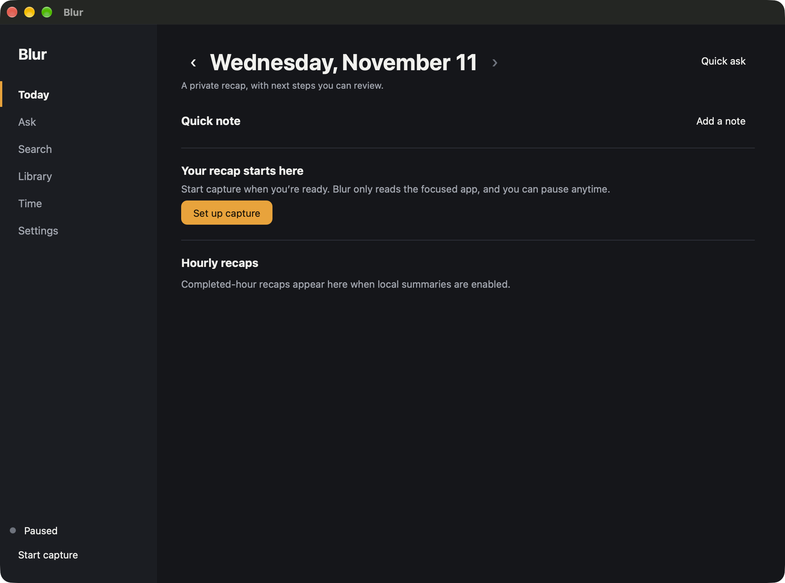
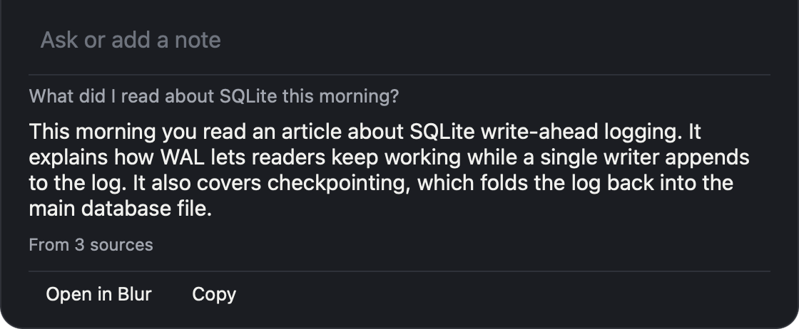

# Blur

Private, local-first memory for you.

[](https://github.com/hazcod/blur/actions/workflows/ci.yml)

Blur is an open-source, cross-platform personal memory app. It keeps a searchable record of your day and answers questions about it. Your memory stays encrypted on your device, and a local planner selects the few items a question needs before a model sees them.

[Website](https://blur.hazcod.com) · [Getting started](docs/getting-started.md) · [Contributing](CONTRIBUTING.md) · [Platform status](docs/project-status.md)

Blur is development software. Windows and Linux have native capture implementations and portable builds, with live desktop validation still in progress.

| Platform | Architectures | Native text capture | Status |
| --- | --- | --- | --- |
| macOS | Apple silicon, Intel | Accessibility | Native desktop app |
| Windows | x86-64 | UI Automation | Experimental; live runtime validation pending |
| Linux | x86-64, ARM64 | AT-SPI2 on X11 | Experimental; live desktop validation pending |





## What Blur does

Blur reads text from the focused app through your operating system's accessibility APIs, stores it in a local encrypted database, and lets you search it or ask questions about it. Answers say where they came from. It never takes screenshots.

- Today: a recap of your day, next steps and notes.
- Ask: questions answered from your memory. General questions never send captured data.
- Correlate: bring related notes, conversations and decisions together in an answer, with sources from across your apps.
- Reminders and follow-ups: optional AI turns your notes into suggested next steps; you review and confirm the ones you want to keep.
- Search: find anything you saw or wrote, by exact words.
- Library: facts about people and projects that you review and keep.
- Time: where your time went, per app and per range.
- Quick ask: fast questions and notes, with a notch panel on macOS.
- Safari capture: an optional macOS extension that requires a separately configured build; it is not included in the default app.

## Why not just let AI read everything?

Most memory tools send your history to a model and let it work things out. Blur works the other way round.

- AI is optional and off by default. Use a local Ollama model or an endpoint you configure. Sending memory evidence to a remote endpoint requires a separate opt-in; that provider may retain requests.
- A local planner reads your question, not a model. It is deterministic. Time questions and questions like "what did you capture from WhatsApp" are answered with no model at all.
- The model only gets a handful of items, selected and size-limited each time, never your whole memory. Blur shows how many items were sent with each answer.
- Daily recaps are built from the short hourly summaries Blur already wrote, so they are a few kilobytes, not hundreds of captures.
- You decide what is captured with allowed and blocked apps and sites, and with timed pauses. You decide how long it is kept, and you can delete all of it.
- Optional folder sync writes encrypted change files to a provider you choose. Enabling MCP lets your client read selected memory results; a hosted client may send those results to its model provider.

## Install

Start with the [getting started guide](docs/getting-started.md) for platform requirements, development builds and first-run setup.

Download builds from [GitHub Releases](https://github.com/hazcod/blur/releases). Windows and Linux archives are unsigned development builds. For a build of a specific commit, the [CI workflow](https://github.com/hazcod/blur/actions/workflows/ci.yml) also uploads portable archives as the `blur-portable` artifact after packaging succeeds; CI artifacts expire after 14 days and require a GitHub sign-in.

## Using Blur

- Capture: in Settings you choose which apps and sites Blur may capture and which it must never capture.
- Quick ask on macOS: open the panel by hovering the notch, from the link in the window, or with the keyboard shortcut you choose. Enter asks, Command+Enter saves a note, and Esc clears the field and then closes the panel.
- Today page: your recap, next steps and notes in one place.
- Ask page: ask questions about your memory and see the sources behind each answer.
- Pause: use the menu bar item to pause capture for 15 minutes, 1 hour or until tomorrow.

## Optional AI

AI is optional and off by default. In Settings, AI, use a local Ollama model or an OpenAI-compatible endpoint that you configure.

With a model enabled, you get hourly recaps, a daily recap and Ask answers. Without one, Blur still captures, stores and searches, and shows a model-free "This hour so far" draft. Search, Library and Time do not need a model.

## Sync across Macs

Blur syncs between your own Macs through a folder carried by iCloud Drive or Dropbox. It writes encrypted, append-only segments protected by a passphrase into the folder you pick. The database itself is never synced, and deletions propagate to your other Macs.

## Claude and other MCP clients

Once enabled in Settings, Connections, `blur mcp` exposes memory search locally to Claude and other MCP clients. It is off by default.

## Build from source

```sh
git clone https://github.com/hazcod/blur.git && cd blur
make macos-app
```

The macOS app lands at `~/Downloads/Blur.app`. On Windows and Linux, `make portable-packages` creates the portable archives under `dist/packages/`. Use the Go toolchain version in [go.mod](go.mod). See [CONTRIBUTING.md](CONTRIBUTING.md) for the development workflow, [docs/releasing.md](docs/releasing.md) for releases and [docs/architecture.md](docs/architecture.md) for the design.

## Status, security and licence

- Status: Blur is in development. See [docs/project-status.md](docs/project-status.md) for platform status and technical detail.
- Security: see [SECURITY.md](SECURITY.md) to report a vulnerability.
- Licence: Apache-2.0, see [LICENSE](LICENSE).
