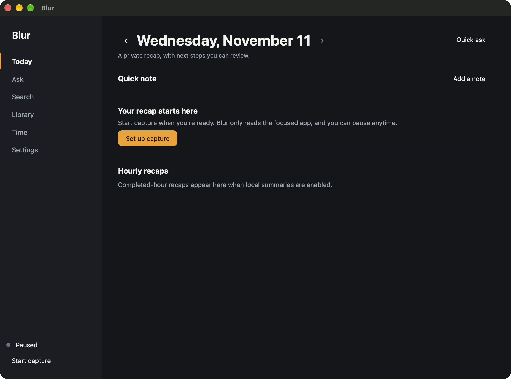
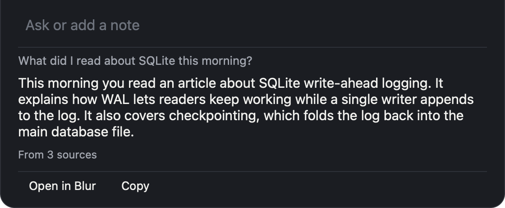

# Blur

Private, local-first memory of what you work on.

[](https://github.com/hazcod/blur/actions/workflows/ci.yml)

Blur is an open-source personal memory app for your desktop (macOS now, Windows and Linux in progress). It keeps a searchable record of your day and answers questions about it. The alternative to letting AI read everything: your memory stays encrypted on your Mac, a local planner picks the few items a question needs, and a model only ever sees those.





## What Blur does

Blur reads the text of the app you are focused on through macOS Accessibility, stores it in a local encrypted database, and lets you search it or ask questions about it. Answers say where they came from. It never takes screenshots.

- Today: a recap of your day, next steps and notes.
- Ask: questions answered from your memory. General questions never send captured data.
- Search: find saved content by words or meaning.
- Library: facts about people and projects that you review and keep.
- Time: where your time went, per app and per range.
- Quick ask: a panel under the notch for fast questions and notes.
- Browser capture: active page text through macOS Accessibility, with an optional Safari extension for additional page capture.

## Why not just let AI read everything?

Most memory tools send your history to a model and let it work things out. Blur works the other way round.

- Nothing leaves your Mac unless you turn on a model. The model is a local Ollama model or an endpoint you configure.
- A local planner reads your question, not a model. It is deterministic. Time questions and questions like "what did you capture from WhatsApp" are answered with no model at all.
- The model only gets a handful of items, selected and size-limited each time, never your whole memory. Blur shows how many items were sent with each answer.
- Daily recaps are built from the short hourly summaries Blur already wrote, so they are a few kilobytes, not hundreds of captures.
- You decide what is captured with allowed and blocked apps and sites, and with timed pauses. You decide how long it is kept, and you can delete all of it.

## Install

Download the latest `Blur.app` from the [releases page](https://github.com/hazcod/blur/releases) and move it to Applications. macOS is the supported target today. Windows and Linux are in progress.

On first launch, grant Blur access in System Settings, Privacy & Security, Accessibility.

## Using Blur

- Capture: in Settings you choose which apps and sites Blur may capture and which it must never capture.
- Capture coverage: Today and Capture settings show the last readable content and any permission, page, domain, timeout or storage problem. On macOS, a periodic refresh catches content that loads after focus; capture rests after three minutes without input.
- Quick ask: open the panel by hovering the notch, from the link in the window, or with Option+Space (the default, configurable in Settings). Launching Blur leaves the panel closed. Enter submits your request, Command+Enter saves a note, and Esc closes the panel. With an empty composer, Up/Down selects an answer and Command+C copies it. The menu icon reflects capture On/Paused; its menu separately reports when the current app is not being captured.
- Today page: your recap, next steps and notes in one place.
- Ask page: ask questions about your memory and see the sources behind each answer. Follow-ups retain the subject and check current evidence; rewriting an answer does not save a note.
- Day and week recaps distribute evidence across the requested period, with dated summaries and captures from gaps. Model context is shared across those sources; the answer shows when selection or excerpts limit coverage.
- Storage errors: startup failures show a recovery reason and copyable diagnostics for storage-folder, database, and Keychain access.
- Pause: use the menu bar item to pause capture for 15 minutes, 1 hour or until tomorrow.

## Optional AI

New, unconfigured macOS installs enable Apple’s on-device system model and automatic Library by default. Existing saved AI choices remain intact. Settings → AI detects Apple Intelligence availability and installed Ollama models, separating answer-capable models from embedding models. If Apple Intelligence is unavailable, Settings explains its state; no cloud provider is selected automatically. Apple’s system model stays on-device and is managed by macOS; Blur does not claim a selectable AFM variant.

Library searches names, aliases, facts, and open loops across the complete encrypted directory, with category filters and 20-entry pages. Preferences provides global text/context search, type/status filters, paging, editing, pause, and deletion. Background indexing preserves Library browsing state. Natural commitments such as “I need to go to the drycleaners on Monday” prepare a reminder and ask for a missing time before scheduling it.

Ollama processing verifies that the selected model is installed locally before sending notes, questions, or captured evidence. Ollama cloud models are refused; remote processing uses the separately configured provider and consent controls.

With an answer model enabled, you get Ask answers and optional local hourly recaps. Without one, Blur still captures, stores and searches exact terms, and shows a model-free "This hour so far" draft. Library and Time do not need an answer model.

Hourly recaps can use bounded excerpts from large saved sources. They disclose excerpted, partial, or omitted evidence. This does not imply that Accessibility capture has read an entire page beyond its capture limit.

**Search by meaning** is enabled by default for new settings. It uses the installed local Ollama embedding model `embeddinggemma`; if needed, install it with `ollama pull embeddinggemma`. An existing choice to disable semantic indexing is preserved. Apple Foundation Models can write answers while EmbeddingGemma retrieves their evidence. Blur backfills saved captures and notes, indexes new content automatically, and combines semantic matches with exact terms in Search, Ask retrieval, and the MCP bridge. Current tasks and reminders are also ranked by meaning, using their live titles, state, schedules, and revision-bound action references. The settings show coverage and paused/unavailable states; an unavailable semantic provider is disclosed rather than treated as proof that no memory was saved. Vectors and source metadata are encrypted in the memory database; the search graph stays in RAM. Cloud embedding models and remote embedding endpoints are refused. Turning it off stops semantic processing and keeps exact search available; deleting sources also deletes their vectors.

### Cloud connections

Settings → AI supports the official **Continue with ChatGPT** account flow and a **Claude API** key connection. Connecting an account does not select it for inference. Choose an account and an available model, save the choice, and separately allow sending saved memory or processing notes. Changing the account, model, destination, workspace, or API key clears those permissions. Background recaps and automatic Library processing remain local.

ChatGPT uses its documented public Sign in with ChatGPT and Responses APIs, with credentials in the OS secret store. The current plan API does not offer a per-request hard output-token cap; Blur limits accepted output bytes and request duration. Claude uses Anthropic’s native Messages API and a hard output-token limit. A Claude consumer subscription is not a generic third-party API login. Search embeddings remain local for every answer provider.

## Sync across Macs

Blur syncs between your own Macs through a folder carried by iCloud Drive or Dropbox. It writes encrypted, append-only segments protected by a passphrase into the folder you pick. The database itself is never synced, and deletions propagate to your other Macs.

## Claude and other MCP clients

Once enabled in Settings, Connections, `blur mcp` exposes memory search locally to Claude and other MCP clients. It is off by default.

## Build from source

```sh
git clone https://github.com/hazcod/blur.git && cd blur
make macos-app-stable
```

The app lands at `~/Downloads/Blur.app`. See [CONTRIBUTING.md](CONTRIBUTING.md) for the development workflow, [docs/releasing.md](docs/releasing.md) for releases and [docs/architecture.md](docs/architecture.md) for the design.

## Status, security and licence

- Status: Blur is in development. See [docs/project-status.md](docs/project-status.md) for platform status and technical detail.
- Security: see [SECURITY.md](SECURITY.md) to report a vulnerability.
- Licence: Apache-2.0, see [LICENSE](LICENSE).
